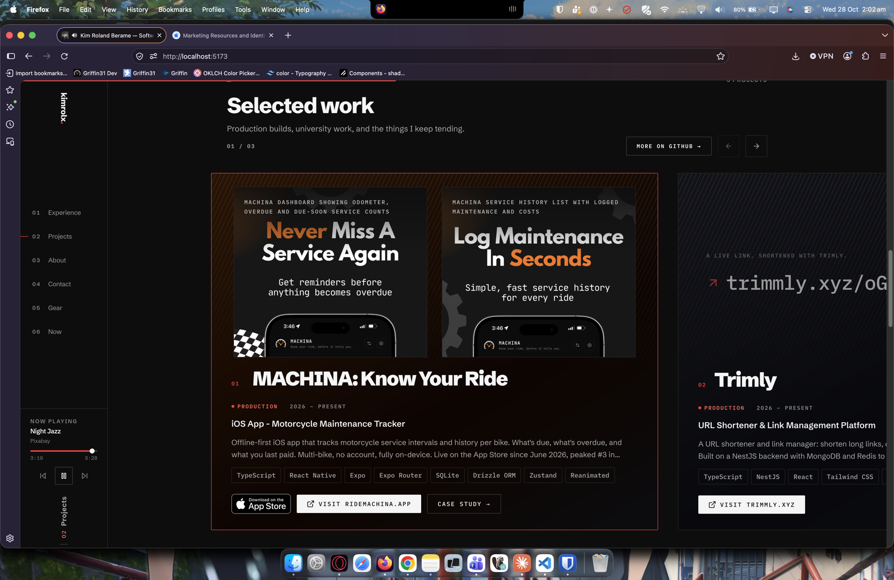
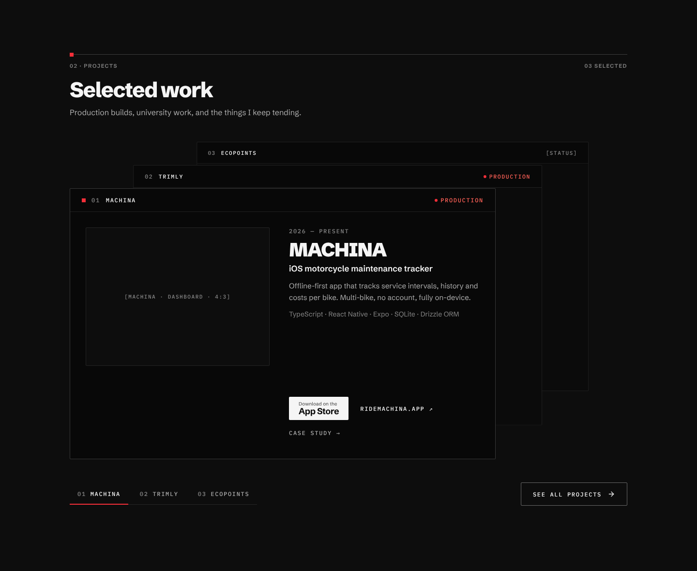
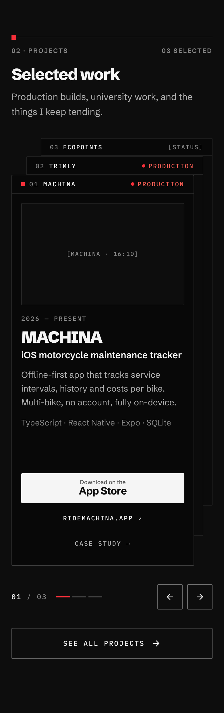
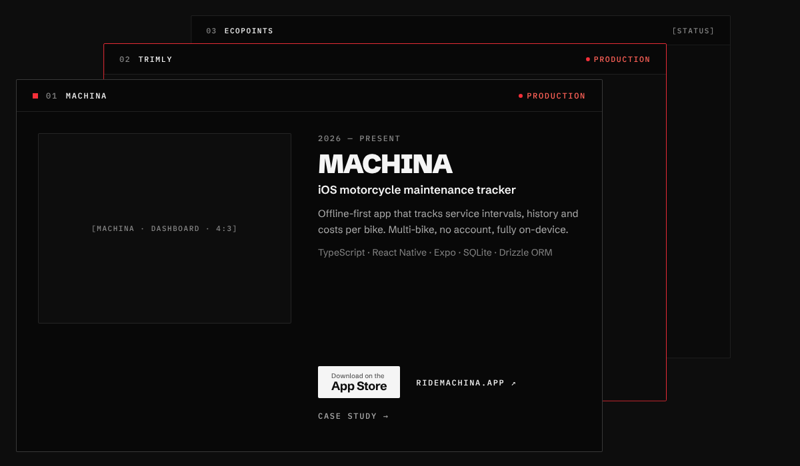
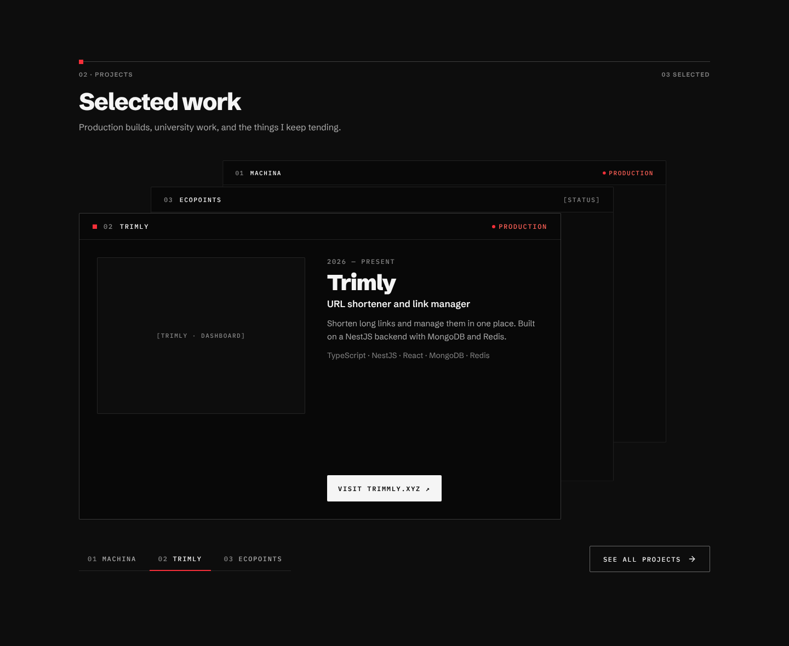
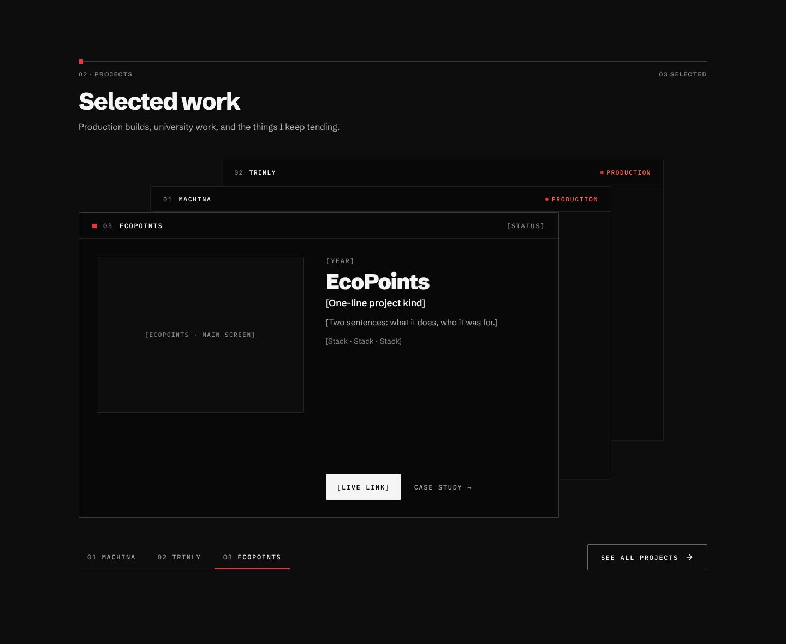
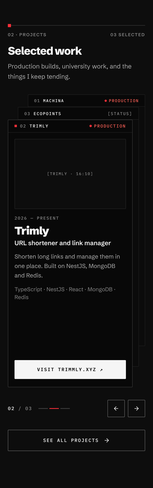
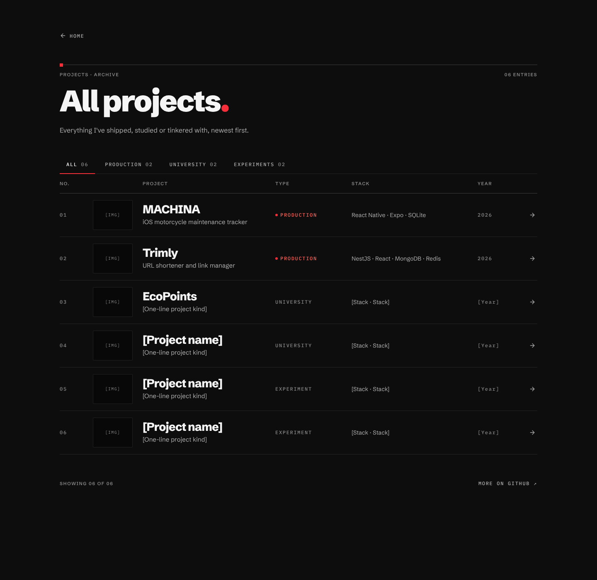
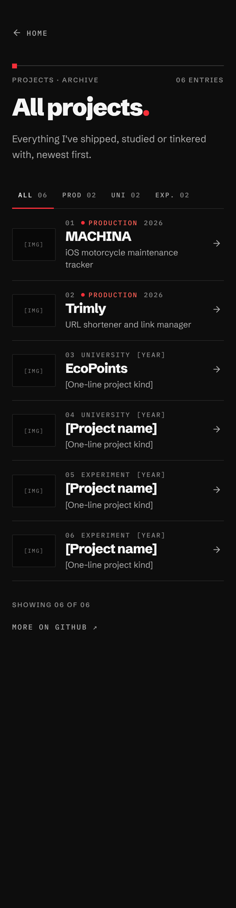

# Handoff: Featured projects "stacked deck" + `/projects` archive

**Repo:** `kimrolx/kimrolx` (portfolio, kimrolx.com)
**Scope:**
1. Replace the landing page's projects section (currently a horizontal carousel) with an interactive **stacked deck** that shows at most 3 featured projects.
2. Add a new **`/projects`** route that lists every project, with type filters.

**Design system:** kimrolx ("The Specimen Sheet"). Follow `DESIGN.md` and the tokens in `src/index.css`. A copy of the token export is in `reference/kimrolx-tokens.json`. Everything below uses **role token names**. Map them to the CSS variables or Tailwind classes the repo already uses, and never hard-code values.

---

## 0. Folder contents

```
HANDOFF.md                         ← this file
screenshots/
  00-before-current-site.png       ← current carousel (what we're replacing)
  01-desktop-default.png           ← landing deck, MACHINA in front
  02-desktop-hover-back-card.png   ← hover state on a back card (Trimly)
  03-desktop-trimly-front.png      ← after clicking Trimly
  04-desktop-ecopoints-front.png   ← after clicking EcoPoints
  05-mobile-default.png            ← mobile deck (390px, @2x)
  06-mobile-after-next.png         ← mobile after tapping "next"
  07-projects-desktop.png          ← /projects page
  08-projects-mobile.png           ← /projects mobile
reference/
  kimrolx-tokens.json              ← design-system tokens export (source of truth for values)
  design-source/*.dc.html          ← the design mockups (HTML + inline styles + JS state logic)
```

The `.dc.html` files are design mockups, not production code. They use a custom templating runtime (`{{holes}}`, `<sc-for>`, `<sc-if>`, `class Component extends DCLogic`). Read them for **exact spacing, sizes, copy and state logic**, then rebuild the result as idiomatic React components in this repo. Don't copy the templating syntax.

---

## 1. Before → after

| Before | After (desktop) | After (mobile) |
|---|---|---|
|  |  |  |

**Problems this fixes in the current carousel:**
- **Red border on the active card.** `accent` is only allowed on hover and focus. The front card now uses `border-strong` plus a red 8px square in its header instead.
- **Image description text renders visibly over the screenshots** (e.g. "MACHINA DASHBOARD SHOWING ODOMETER…"). Alt text must stay in `alt`, never be painted on the image.
- **Three CTAs with equal weight** (App Store badge, a white "Visit" button, an outlined "Case study"). There is now one solid primary per project and everything else is a text link.
- **Too much text per card:** an 8-chip tech row and a truncated description. Now it's a two-line description and a single stack line.
- **Two of three projects hidden behind arrow clicks.** In the deck, every project's name and status is always visible.

---

## 2. Landing section: stacked deck

### 2.1 Structure

```
<section aria-labelledby="projects-heading">
  SheetHeading     rule + 8px accent tick · "02 · Projects" (left) · "03 selected" (right)
  h2               "Selected work"
  p                "Production builds, university work, and the things I keep tending."
  Deck             3 absolutely-positioned ProjectCards (max 3)
  Footer row       project tabs (left) · "See all projects →" outline button (right)
</section>
```

### 2.2 Deck geometry (desktop ≥ 1024px)

Container: `position: relative; width: 100%` (content column is `content-max` = 72rem = 1152px); `height: 656px`.
Every card: `position: absolute; width: 880px; height: 560px; transform-origin: top right`.

| Depth | Role | left | top | scale | z-index | border | body |
|---|---|---|---|---|---|---|---|
| 0 | front | 0 | 96px | 1 | 3 | `border-strong` | full detail |
| 1 | back | 96px | 48px | 0.96 | 2 | `border-subtle` | media only, opacity `opacity-recede` (0.6) |
| 2 | back | 192px | 0 | 0.92 | 1 | `border-subtle` | media only, opacity 0.6 |

Each back card sits 96px to the right and 48px above the card in front of it. The 48px offset matches the card's 48px header strip, so each back card's **header strip is always fully visible**. That strip carries the project's name and status. No shadows: depth comes from offset, scale, border tone and dimmed media, per the design system's "depth is tone, not shadow" rule.

**Depth assignment:** `depth = (index - frontIndex + n) % n`, where `n` is the number of projects. Clicking a back card sets `frontIndex = thatIndex` (a rotation, so the order stays consistent). See `renderVals()` in `reference/design-source/landing-deck-desktop.dc.html`.

### 2.3 ProjectCard anatomy

Card: `surface-sunken`, `radius-sm` (2px), `border-hairline`, `overflow: hidden`, flex column.

**Header strip** (all depths): height 48px, padding `0 24px`, `border-bottom: border-subtle`, `mono-label` (IBM Plex Mono, 12px/500, 0.14em, uppercase).
- **Left:** [front only: 8×8 `accent` square] · `01` in `text-meta` · project name in `text-primary`
- **Right:** StatusPill. For a live project (Production): a 6px `status-live` dot plus the word in `text-accent`. For any other status: the word only, in `text-meta`.

**Front body:** padding 32px; grid `380px | 1fr`, gap 40px.
- **Media:** 4:3 frame, `surface-page` fill, `border-subtle`, `radius-sm`. Use real screenshots (see open items), full color, never tinted.
- **Text column** (flex column, gap 12px):
  - Period: `mono-label`, `text-meta` (e.g. "2026 — Present")
  - Title: `title-lg` (40px/900/-0.04em, line-height 0.95), `text-primary`
  - Kind: `subtitle` (17px/600)
  - Description: `body-compact` (15px/1.62), `text-secondary`, **two lines max**
  - Stack: `body-sm` (14px), `text-meta`, nouns joined by a middle dot (" · ")
  - Spacer (`flex: 1`), so the CTAs pin to the bottom
  - CTA row (see 2.4)

**Back body:** the media slot fills the card body at `opacity: 0.6`, with **no text**. Text cut off mid-sentence looked broken when it peeked out. When a back card comes to the front, its body switches to full detail.

### 2.4 CTA hierarchy (per project, same on every card)

| Tier | Style | MACHINA | Trimly | EcoPoints |
|---|---|---|---|---|
| Primary (solid) | `surface-inverse` fill, `text-inverse`, height 48px, padding `0 20px`, `radius-sm` | **AppStoreBadge** | "Visit trimmly.xyz ↗" (mono-label 600) | "[Live link]" |
| Secondary (text link) | `mono-label`, `text-primary`, min-height 44px | "ridemachina.app ↗" | — | — |
| Tertiary (text link) | `mono-label`, `text-secondary` | "Case study →" | — | "Case study →" |

Row: `flex-wrap: wrap; column-gap: 24px; row-gap: 4px`.

**Section-level CTA:** "See all projects →" is an **outline** button (`border-control` 1px, `text-primary`, height 48px, padding `0 24px`, `mono-label`, Feather `FiArrowRight`). It sits one step below the per-project primaries on purpose. It links to `/projects` and **replaces "More on GitHub"**, which moves to `/projects`.

Use the existing `Button` (`src/components/base-components/button.tsx`) and `AppStoreBadge` (`src/components/AppStoreBadge.tsx`) wherever their variants match.

### 2.5 Footer row

`display: flex; justify-content: space-between; align-items: center`. The section uses `gap: 48px` between the heading, deck and footer.

- **Left:** a project tab group. Each tab is a `<button aria-pressed>`, `mono-label`, min-height 44px, padding `0 16px`, with a 2px bottom border: `accent` when active, transparent otherwise. Active label is `text-primary`, inactive `text-secondary`. The number prefix is `text-meta`. The group has a `border-subtle` bottom rule.
- **Right:** the "See all projects" outline button.

### 2.6 States and motion



| Interaction | Result |
|---|---|
| Hover a back card | lifts 6px (CSS `translate: 0 -6px`, `duration-fast` 200ms), border → `border-accent`, name in the header → `text-accent`, media opacity 0.6 → 0.85 |
| Click a back card | it becomes the front card; every card animates `left`, `top` and `transform` over `duration-slow` (500ms) `ease-out-expo` |
| Click a tab | same as clicking that card |
| Hover a primary button | 1px lift, fill dims to `text-secondary` |
| Hover a text link | color → `text-accent` |
| Focus (any control) | `focus-ring`, 2px, offset 3px |
| `prefers-reduced-motion` | no transitions, instant swap |

After a swap:

| Trimly front | EcoPoints front |
|---|---|
|  |  |

### 2.7 Accessibility (required)

- **Back cards:** each has a full-cover `<button type="button" aria-label="Show Trimly">` layered over its body. Links inside back cards are not rendered (back cards show media only).
- **Cards:** each card is an `<article aria-label="Project 2 of 3: Trimly">`.
- **Tabs:** they are the keyboard path. Never rely on the cover buttons alone, because their center is hidden under the front card.
- **Live region (recommended):** a visually hidden `aria-live="polite"` region announcing "Showing Trimly, 2 of 3" when the front card changes.
- **Media:** real alt text that describes the screenshot. Never visible caption text over the image.
- **Touch targets:** all controls ≥ `size-target` (44px).

### 2.8 Mobile (< 640px)

| Default | After "next" |
|---|---|
|  |  |

- **Gutter:** 20px. Deck container height 744px. Card width 318px (column width minus 32px), height 680px.
- **Depth positions:** front `left 0, top 64px, scale 1`; back 1 `left 16px, top 32px, scale 0.97`; back 2 `left 32px, top 0, scale 0.94`.
- **Header strip:** 32px tall, padding `0 16px`, mono 11px.
- **Front body:** padding 16px, stacked: 16:10 media, period, title (28px/900), kind (16px/600), description, stack, then CTAs at full width. The order is primary (App Store badge 52px tall, or a solid 48px button), then the secondary and tertiary links **stacked**, each full-width at 44px min-height.
- **Swipe:** on the front card, `pointerdown` then `pointerup` with dx < -40px goes to next and dx > 40px goes to previous. Use `touch-action: pan-y` so vertical page scroll still works.
- **Controls row** under the deck:
  - Counter `01 / 03` (mono)
  - Three 24×2px progress steps (`accent` for the active one, `border-strong` for the rest)
  - Previous/next 44×44 icon buttons (`border-control`, Feather `FiArrowLeft` / `FiArrowRight`, with `aria-label`)
- **CTA:** "See all projects →" outline button, full-width, 52px tall.

**Tablet (640–1023px):** not designed. Recommended: the mobile layout with `gutter-wide` and the card width capped at about 560px, or the desktop deck scaled down so the card is about 640px wide. Pick whichever is less code and flag it.

### 2.9 Content (data)

Define the projects in one data file (reuse the existing project data source if there is one) and flag which three are featured. The landing section renders at most 3, in this order:

```ts
{
  id: 'machina', name: 'MACHINA', status: 'Production', live: true,
  period: '2026 — Present', kind: 'iOS motorcycle maintenance tracker',
  description: 'Offline-first app that tracks service intervals, history and costs per bike. Multi-bike, no account, fully on-device.',
  stack: ['TypeScript', 'React Native', 'Expo', 'SQLite', 'Drizzle ORM'],
  primary: { kind: 'appStore', href: '<App Store URL>' },
  secondary: { label: 'ridemachina.app', href: 'https://ridemachina.app' },
  caseStudy: true,
},
{
  id: 'trimly', name: 'Trimly', status: 'Production', live: true,
  period: '2026 — Present', kind: 'URL shortener and link manager',
  description: 'Shorten long links and manage them in one place. Built on a NestJS backend with MongoDB and Redis.',
  stack: ['TypeScript', 'NestJS', 'React', 'MongoDB', 'Redis'],
  primary: { kind: 'button', label: 'Visit trimmly.xyz', href: 'https://trimmly.xyz' },
  caseStudy: false,
},
{
  id: 'ecopoints', name: 'EcoPoints', /* TODO: status, period, kind, description, stack, links */
}
```

The mobile deck uses a shorter stack line for MACHINA (TypeScript · React Native · Expo · SQLite) so it fits two lines.

---

## 3. `/projects` page (archive)

| Desktop | Mobile |
|---|---|
|  |  |

### 3.1 Structure

- **Back link:** "← Home" text link (`mono-label`, `FiArrowLeft`), min-height 44px.
- **SheetHeading:** "Projects · Archive" · "{NN} entries".
- **h1:** "All projects." in the `display` style (72px/900/-0.04em, line-height 0.92; fluid `fs-display`). The period is `accent`, echoing the hero name.
- **Intro:** "Everything I've shipped, studied or tinkered with, newest first." (`body`, `text-secondary`)
- **Filter group:** `role="group" aria-label="Filter projects by type"` containing `<button aria-pressed>` items: **All · Production · University · Experiments**, each with a zero-padded count in `text-meta`. Styled like the landing tabs (2px `accent` underline on the active one).
- **Table header (desktop only, `aria-hidden`):** No. · Project · Type · Stack · Year, in the `label` style, `border-bottom: border-strong`.
- **List:** an `<ol>` of rows. Each row is one `<a>` (to the case study, or to the live link if there is none).
  - **Desktop grid:** `56px 96px 1fr 160px 280px 96px 24px`, gap 24px, padding `16px 0`, `border-bottom: border-subtle`.
  - **Cells:** number (mono, `text-meta`) · 96×72 thumbnail (`surface-sunken`, `border-subtle`) · name (`title` 28px/800) over kind (15px, `text-secondary`) · type (mono-label, with a live dot and `text-accent` for Production, `text-meta` otherwise) · stack (`body-sm`, `text-secondary`) · year (mono, `text-meta`) · `FiArrowRight`.
  - **Row hover:** name → `text-accent`; the arrow shifts 4px right and turns `text-accent`.
- **Footer row:** "Showing {shown} of {total}" (`label`, `text-meta`) on the left; "More on GitHub ↗" text link on the right.
- **Filtering:** client-side. Optionally sync to `?type=production` so filtered views are linkable.

### 3.2 Mobile

- **Rows:** grid `72px 1fr 20px`. A 72×54 thumbnail; then a meta line (number · type · year, mono 11px), the name (22px/800) and the kind (14px); then an arrow.
- **Filters:** wrap. The mockup shortens the labels to "Prod / Uni / Exp." so they fit one line. Full words wrapping onto two lines is acceptable if preferred.

---

## 4. Implementation notes

- **Components:** reuse what exists before creating new ones. Likely touch points from the design-system export:
  - `src/components/ProjectPanel.tsx`: the current project card (rename or replace as `DeckCard`)
  - `src/components/ProjectMedia.tsx` (DemoLink, media frame)
  - `src/components/StatusPill.tsx`, `src/components/SheetHeading.tsx`, `src/components/AppStoreBadge.tsx`, `src/components/base-components/button.tsx`
  - `src/components/TechTag.tsx` (TechList): no longer used in the deck, which uses a dot-joined spec line instead
- **Icons:** `react-icons`. Feather (`Fi*`) for arrows, Font Awesome `FaApple` inside the App Store badge.
- **Routing:** add `/projects` to the existing router. "See all projects" must be a real link (`<a href>` or the router's `<Link>`), not a button.
- **No new dependencies** for the animation. CSS transitions on `left`, `top` and `transform` are enough. If the repo already uses a motion library, it's fine to use it, but respect reduced motion.
- **Constraints:**
  - The deck needs a fixed card height (560px desktop, 680px mobile) so the stack stays aligned. Keep descriptions to about two lines.
  - Each card's internal layout must not shift on swap. Only position, scale and border animate.
- **Remove** the old carousel's arrows, counter and red active border.

---

## 5. Acceptance criteria

- [ ] **Landing section** shows at most 3 featured projects as a stacked deck, matching screenshots 01–04 at 1440px.
- [ ] **Back cards:** each one's header strip (number, name, status) is fully visible at every depth.
- [ ] **Swapping:** clicking any back card or tab brings that project to the front with a 500ms ease-out-expo move. With reduced motion, the swap is instant.
- [ ] **Keyboard:** Tab reaches the project tabs and every front-card link, and Enter or Space on a tab swaps. Focus rings are visible.
- [ ] **CTAs:** exactly one solid primary per project. The section CTA is an outline "See all projects →" linking to `/projects`.
- [ ] **Accent usage:** no `accent` border on the resting front card, and no colored fills behind text.
- [ ] **Alt text** is not rendered visibly on any image.
- [ ] **Mobile:** swipe left and right cycles cards, the arrows and counter work, and vertical scroll is not blocked. Matches screenshots 05–06.
- [ ] **`/projects` page:**
  - [ ] Renders all projects, matching screenshots 07–08.
  - [ ] Filters update the list and the "Showing X of Y" count.
  - [ ] "More on GitHub" lives here.
- [ ] **Themes:** all colors come from role tokens, so the Paper (light) theme works without changes.

---

## 6. Open items (owner: Kim)

- **Screenshots:**
  - Real, text-free app screenshots for each card: 4:3 on desktop, 16:10 on mobile.
  - 96×72 thumbnails for `/projects`.
  - The mockups use labelled placeholders.
- **EcoPoints:** status, period, one-line kind, description, stack and links. It's filed under **University** on `/projects`, which is an assumption.
- **The rest of the archive:** the remaining projects for `/projects`. Rows 04–06 in the mockup are placeholders.
- **App Store URL** for the MACHINA badge.
- **MACHINA ranking (optional):** the old description ended with "peaked #3 in…" but was cut off. If you want the ranking back, supply the full claim.
